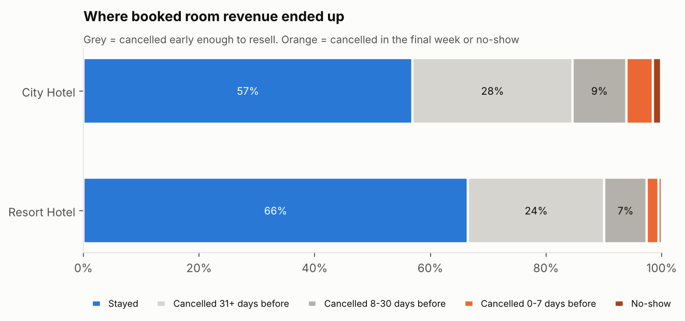
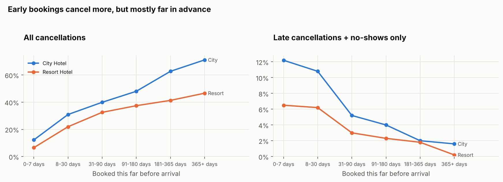
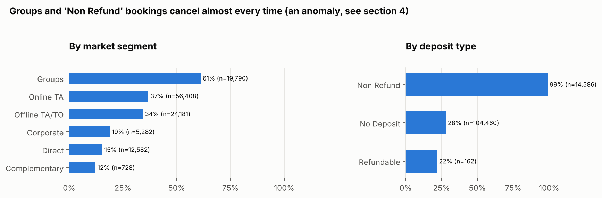
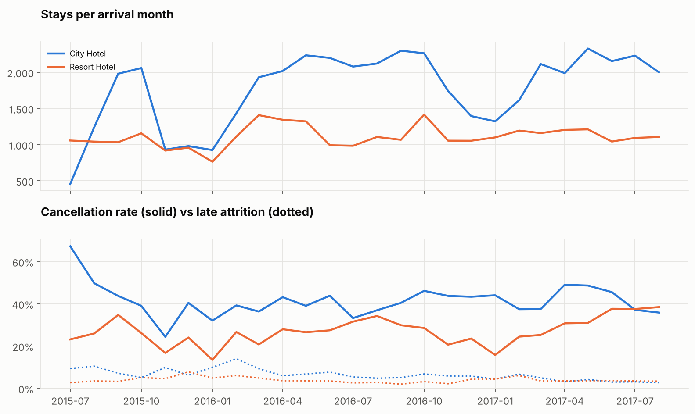
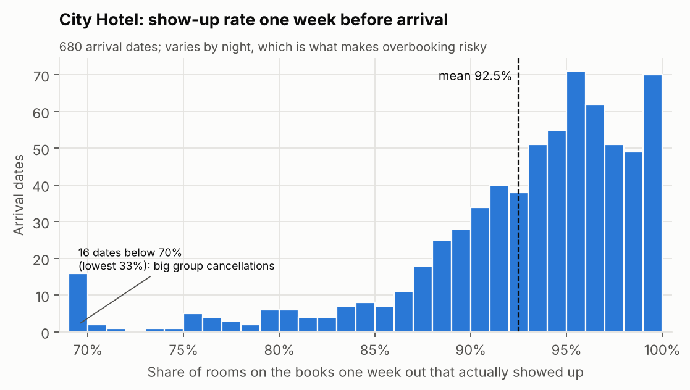
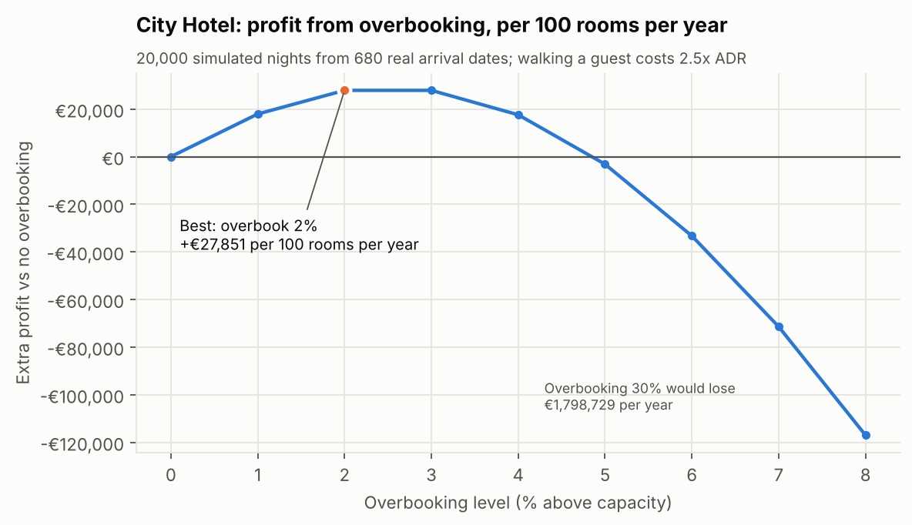
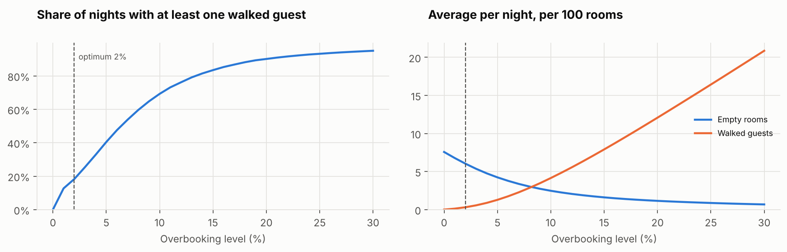
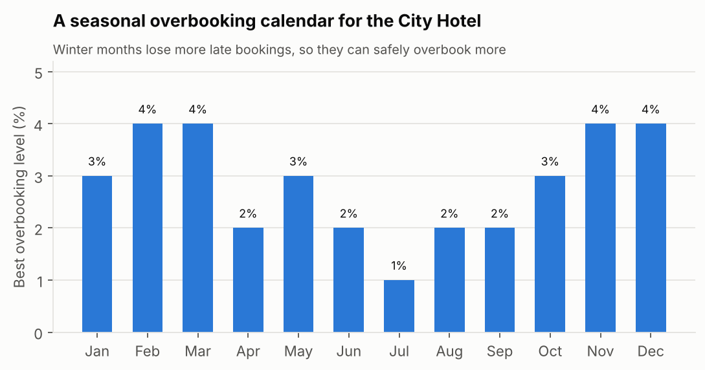

# 42% of Bookings Cancel. So Why Shouldn't This Hotel Overbook by 42%? Cancellation Analytics and Overbooking Policy

**A city hotel's revenue manager sees a 42% cancellation rate and wonders how aggressively to overbook. This project shows that the headline number is the wrong input. Only 6% of bookings disappear too late to resell. A simulation built on real show-up data finds the overbooking level that maximizes profit: about 2–3%, not 42%.**

| | |
|---|---|
| **Business question** | How much revenue do cancellations really cost, and how many extra rooms should the hotel sell? |
| **Data** | [Hotel Booking Demand](https://github.com/rfordatascience/tidytuesday/tree/master/data/2020/2020-02-11) (Antonio, Almeida & Nunes, *Data in Brief*, 2019): 119,390 real bookings from a city hotel and a resort hotel in Portugal, Jul 2015 – Aug 2017 |
| **Methods** | SQL analytics (DuckDB), data-quality auditing, anomaly investigation, Monte Carlo simulation, decision optimization, sensitivity analysis |
| **Tools** | SQL (DuckDB), Python, pandas, NumPy, matplotlib, pytest |
| **Headline result** | Overbook the City Hotel by **2%**: **+€27,851 per 100 rooms per year**, with a walked guest on ~18% of nights. Overbooking by the "obvious" 72% (enough to cover a 42% cancellation rate) would walk **59 guests per night**. |

---

## 1. The business problem

Hotels sell a perishable product: an unsold room tonight is revenue gone forever. Cancellations and no-shows leave rooms empty, so hotels **overbook**, accepting more reservations than rooms. Overbook too little and rooms sit empty. Overbook too much and guests arrive to no room and have to be "walked" to another hotel at the hotel's expense, with damage to the relationship.

The revenue manager needs answers to three questions:
1. How much revenue is *actually* lost to cancellations? (Section 4)
2. Which bookings cancel, and when? (Section 4)
3. What overbooking level maximizes expected profit, and how much risk comes with it? (Section 5)

---

## 2. Repository structure

```
hotel-cancellations-overbooking/
├── run_all.py                     # runs everything
├── sql/                           # all analysis logic lives in plain SQL
│   ├── 00_build_clean_table.sql   # cleaning + derived columns (documented inline)
│   ├── 01_data_quality.sql        # audit of what was found / removed
│   ├── 02_kpis_by_hotel.sql
│   ├── 03_cancel_by_lead_time.sql
│   ├── 04_cancel_by_segment_deposit.sql
│   ├── 05_nonrefund_anomaly.sql   # investigating a counter-intuitive result
│   ├── 06_monthly_trend.sql
│   ├── 07_outcome_and_revenue.sql # where booked revenue ended up
│   └── 08_nightly_show_rates.sql  # simulation input
├── src/
│   ├── config.py                  # paths + business assumptions
│   ├── db.py                      # runs .sql files against DuckDB
│   ├── analysis.py                # executes SQL, saves tables, draws figures 1–5
│   ├── overbooking.py             # Monte Carlo simulation, figures 6–8
│   └── style.py                   # shared, colorblind-safe chart style
├── tests/test_overbooking.py      # sanity tests for the simulation logic
└── reports/
    ├── tables/                    # every query result as CSV
    └── figures/
```

### Run it

```bash
python -m venv .venv && source .venv/bin/activate   # Windows: .venv\Scripts\activate
pip install -r requirements.txt
python run_all.py      # downloads data, builds DuckDB database, writes reports/ (~10 seconds)
pytest                 # 4 tests
```

The SQL files run on their own too. Open `data/hotel.duckdb` in the DuckDB CLI or DBeaver and run any file from `sql/`.

---

## 3. Data cleaning ([`sql/00_build_clean_table.sql`](sql/00_build_clean_table.sql))

| Issue | Rows | Decision |
|---|---|---|
| Negative average daily rate (ADR) | 1 | Removed (entry error) |
| ADR of €5,400 (next highest ~€500) | 1 | Removed (entry error) |
| Bookings with zero guests | 180 | Removed (not real stays) |
| Missing `children` | 4 | Set to 0 |
| Zero-night stays (day use) | 715 | **Kept**: real bookings with zero room revenue |
| Exact duplicate rows | 31,994 | **Kept**: see below |
| **Rows after cleaning** | **119,208** | |

**Why the duplicates were kept.** A quarter of the rows have an identical twin, and dropping them would be the reflex. But the dataset has no booking ID, and duplicates are concentrated in group and tour-operator segments, where a block of identical rooms (same dates, same rate, same agent) is exactly what a real booking looks like. Dropping them would delete real group business and bias every rate toward individual travelers.

**Derived columns:** a proper `arrival_date` (the raw file splits it across three columns with the month as a word), `booking_date`, `nights`, `booked_revenue = ADR × nights`, lead-time buckets, and an `outcome` that records *when* each cancellation happened, using `reservation_status_date`.

---

## 4. Analysis

### Headline KPIs ([`sql/02_kpis_by_hotel.sql`](sql/02_kpis_by_hotel.sql))

| | Bookings | Cancellation rate | **Late cancellation + no-show rate** | Median lead time | ADR (stayed) |
|---|---|---|---|---|---|
| City Hotel | 79,162 | **41.8%** | **6.0%** | 74 days | €106 |
| Resort Hotel | 40,046 | 27.8% | 3.9% | 57 days | €91 |

The gap between those two columns drives the whole project.

### Most cancelled revenue was resellable ([`sql/07_outcome_and_revenue.sql`](sql/07_outcome_and_revenue.sql))


Of the City Hotel's booked room revenue:
- **57%** (€14.4M) was realized.
- **37%** was cancelled **8+ days before arrival** (the median City Hotel cancellation happens 58 days ahead). The hotel had weeks or months to resell those rooms.
- Only **6%** (€1.5M) was lost to cancellations in the final week (4.6%) or no-shows (1.4%). That is the revenue overbooking is meant to protect.

The headline cancellation rate overstates the hard-to-recover problem by about **7x**.

### Lead time works in two directions ([`sql/03_cancel_by_lead_time.sql`](sql/03_cancel_by_lead_time.sql))


- Bookings made a year or more ahead cancel **71%** of the time at the City Hotel, versus **12%** for bookings made within a week.
- But the pattern **reverses** for late attrition. Last-minute bookings are the most likely to vanish in the final week (12% vs under 2%). (For bookings made inside a week, every cancellation is "late" by definition.)

So long-lead bookings are noisy but harmless. Short-lead and corporate bookings create the real empty-room risk.

### Segments, and an anomaly worth investigating ([`sql/04`](sql/04_cancel_by_segment_deposit.sql), [`sql/05`](sql/05_nonrefund_anomaly.sql))


Groups cancel 61% of the time; Direct and Corporate bookings 15–19%. But **non-refundable bookings cancel 99.4% of the time.** Paying a non-refundable deposit should make someone *less* likely to cancel, so this needed a closer look:

| | No Deposit | Non Refund |
|---|---|---|
| Bookings | 104,460 | 14,586 |
| Cancellation rate | 28.4% | **99.4%** |
| Group or tour-operator segment | 28% | **97%** |
| From Portugal | 33% | **97%** |
| Median lead time | 57 days | **183 days** |
| Avg special requests | 0.65 | **0.00** |
| Median days cancelled before arrival | 35 | **102** |

These don't look like individual guests losing money on a cancelled holiday. They look like **room blocks held by domestic tour operators and released months in advance**: no special requests (no actual guest yet), booked half a year out, released ~3 months before arrival. The "Non Refund" label most likely reflects the contract type, not a deposit anyone forfeited.

**Why it matters:** a cancellation-prediction model trained naively on this data would learn "non-refundable = will cancel" and score it as the strongest predictor. That's true in this data, but it describes inventory management, not guest behavior. Allotment releases should be tracked separately from guest cancellations.

### Seasonality ([`sql/06_monthly_trend.sql`](sql/06_monthly_trend.sql))


The City Hotel's stays collapse each winter (Nov–Feb) and peak in spring and summer. The Resort is steadier. The cancellation rate (solid) swings between roughly 15% and 50% (67% in the first, partial month), while late attrition (dotted) stays in a much narrower 2–14% band. *(July 2015 and August 2017 are the partial edges of the data.)*

---

## 5. How much should the City Hotel overbook? ([`src/overbooking.py`](src/overbooking.py))

### The input: what happens to rooms on the books one week out ([`sql/08_nightly_show_rates.sql`](sql/08_nightly_show_rates.sql))

For each of 680 arrival dates, the query takes every booking that was still active 7 days before arrival and measures what share actually showed up.



On average **92.5%** show up, so ~7.5 rooms per 100 go empty with no overbooking. But the distribution has a **long left tail**: 16 dates lost more than 30% of their bookings (worst: only 33% showed), almost certainly group cancellations. That tail is what makes overbooking dangerous, and an average-based formula would ignore it.

### The model

For each simulated night (20,000 of them):
1. Draw a **real** historical night's show rate and ADR. Sampling real nights keeps the bad group-cancellation nights in the simulation.
2. The hotel holds `100 × (1 + overbook%)` bookings; each shows up with that night's probability.
3. Profit = occupied rooms × ADR − walked guests × ADR × **2.5**.

The walk cost of 2.5× ADR covers a comparable room at a nearby hotel at short-notice rates, transport and a goodwill credit, and the risk of losing the guest's future business. It is an assumption, so it's stress-tested below. Every overbooking level is evaluated on the **same** simulated nights (common random numbers), so differences between levels are due to the policy, not to luck.

### Result


| Overbook | Extra profit / 100 rooms / year | Nights with a walked guest | Avg walked / night | Avg empty rooms / night |
|---|---|---|---|---|
| 0% | – | 0% | 0 | 7.6 |
| 1% | +€17,923 | 13% | 0.13 | 6.8 |
| **2%** | **+€27,851** | **18%** | **0.31** | **6.0** |
| 3% | +€27,850 | 25% | 0.56 | 5.4 |
| 4% | +€17,591 | 33% | 0.88 | 4.8 |
| 5% | −€3,174 | 40% | 1.28 | 4.2 |
| 72% ("cover the 42%") | **−€5.5M** | 99% | **59.2** | 0.2 |

- **2% and 3% tie on profit.** Choose **2%**: same money, with a walked guest on 18% of nights instead of 25%.
- This matches the classic newsvendor rule. Keep accepting bookings while the chance of having to walk someone is below *cost of an empty room ÷ (cost of empty room + cost of a walk)* = 1 ÷ (1 + 2.5) ≈ **29%**. That threshold is crossed between 3% (25%) and 4% (33%).
- The gain is about **0.8% of room profit**. That's modest, but it costs nothing to implement.
- Even optimally, 6 of the 7.6 empty rooms remain. Overbooking alone can't fix late attrition; it needs the policy changes in Section 6.



### A seasonal policy


Winter months have lower show-up rates (~90–91% in Jan–Mar vs ~94% in July) and support **3–4%** (Nov–Mar). Peak summer supports only **1–2%**. Each month rests on 37–79 nights of data, so treat this as "higher in winter, lower in summer" rather than exact numbers.

### Sensitivity to walk cost ([`overbooking_walk_cost_sensitivity.csv`](reports/tables/overbooking_walk_cost_sensitivity.csv))

| Walk cost (× ADR) | 1.5 | 2.0 | 2.5 | 3.0 | 4.0 | 5.0 |
|---|---|---|---|---|---|---|
| Best overbooking | 4% | 3% | 3% | 2% | 1% | 1% |
| Extra profit / 100 rooms / yr | €54.8k | €40.7k | €29.5k | €23.1k | €11.4k | €6.5k |

Across every plausible walk cost, the answer stays in **1–4%** and always earns money. The conclusion holds even though the exact cost is uncertain. *(At 2.5×, this 10,000-night run picks 3% instead of 2%; the two are tied, as shown above.)*

---

## 6. Recommendations

1. **Stop using the headline cancellation rate for capacity decisions.** Report *late* attrition (final-week cancellations + no-shows) as the KPI for overbooking: 6.0% at the City Hotel, 3.9% at the Resort.
2. **Overbook the City Hotel by ~2%**, rising to 3–4% in Nov–Mar and falling to 1–2% in Jul–Aug. Expected gain: ~€28k per 100 rooms per year.
3. **Track tour-operator allotment releases separately** from guest cancellations. They are 12% of all bookings and distort every cancellation metric and any predictive model.
4. **Target late attrition directly**, since overbooking recovers only ~1.5 of 7.6 empty rooms per 100:
   - Require a one-night charge for cancellations inside 7 days, especially for short-lead and corporate bookings (highest late-attrition segments).
   - Send a reconfirmation message 3–5 days before arrival to bring cancellations forward while rooms can still be resold.
5. **Pre-arrange walk agreements** with nearby hotels. Lowering the walk cost from 2.5× to 1.5× ADR nearly doubles the value of overbooking (€29.5k → €54.8k).

---

## 7. Limitations

- **Arrival-date level, not stay-night level.** The simulation treats each arrival date as one night. A production system would track occupancy for every night of multi-night stays.
- **Assumes the hotel sells out.** Overbooking only matters on nights when demand exceeds capacity. The gains apply to sold-out nights; on slow nights the policy changes nothing.
- **Room capacity is unknown** in the data, so results are reported per 100 rooms and scale linearly.
- **No room types.** Real overbooking happens per room type, with upgrades as a buffer, which would allow slightly higher levels.
- **Historic data (2015–2017)**, from two hotels in one country. Booking behavior has changed since (e.g., flexible-rate popularity after 2020), so the *method* transfers better than the exact numbers.

## Next steps
- Predict each booking's probability of late attrition (rather than any cancellation) and overbook against the sum of predicted no-shows for each night
- Rebuild the simulation at the room-type × stay-night level
- A dashboard showing tonight's on-the-books count, expected shows and recommended extra sales
